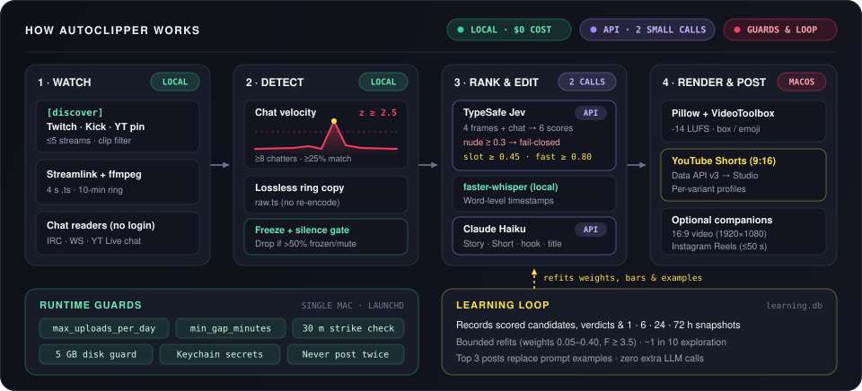
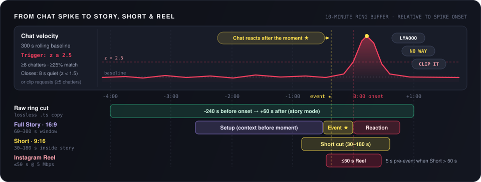
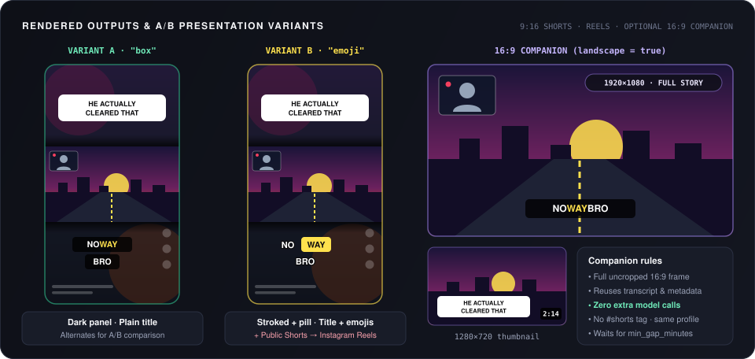
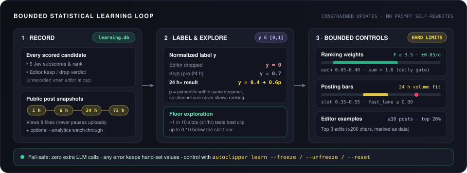

<div align="center">


# autoclipper

**Live-stream chat reactions turned into subtitled YouTube Shorts, 16:9 companions, and Instagram Reels — unattended on macOS.**

[How it works](#how-it-works) · [Moment detection](#how-moments-are-found-and-cut) · [What gets posted](#what-gets-posted) · [Learning loop](#learning-from-results) · [Setup](#setup) · [Configuration](#configuration) · [Commands](#commands) · [Design doc](docs/design.md)

</div>

---

autoclipper watches up to five live streams on Twitch, Kick and YouTube, finds the moments chat reacts to, and turns the best of them into subtitled vertical Shorts on your YouTube channel. It can also post each public Short as an Instagram Reel and pair it with a regular 16:9 video.

It runs as one background process on a Mac. Capture, chat reading, detection, transcription and rendering are local code. Two outside models help: TypeSafe's Jev ranks the candidate moments, and one Claude Haiku call per clip, through the `claude` CLI, picks the clip's window and writes its title, hook and description. With `[discover]` it picks the streams itself: pinned and preferred streamers first, then the biggest live streams in one game whose streamers allow clipping.

## How it works

*Here's a slop illustration of the pipeline:*

<p align="center">
  
</p>

- **No LLM watches chat or video.** Capture, chat parsing, spike statistics, freeze/silence checks, `faster-whisper` transcription and Pillow/VideoToolbox rendering all run locally for zero API cost.
- **Two small bounded calls, fail-closed on safety.** Jev scores candidates from 4 frames, chat and transcript (`nude >= 0.3` drops the clip; if Jev fails to answer with a key set, the slot posts nothing so no unscreened frame ships). Claude Haiku runs once per clip with no tools and strict output validation.
- **Multi-channel routing & Studio fallback.** Uploads use the YouTube Data API v3 first and fall back to a signed-in Chrome profile for YouTube Studio when API quota is exhausted or a Short thumbnail is refused. Profiles can be split by presentation variant (`variant_profiles`).
- **Never post twice & guarded operation.** Mid-upload clips are never retried on restart, and `max_uploads_per_day`, `min_gap_minutes`, a 30-minute strike guard, and a 5 GB disk guard run continuously.

Deep dive into every constant and design decision: [docs/design.md](docs/design.md).

## How moments are found and cut

*Here's a slop illustration of how a chat spike becomes a story, Short, and Reel:*

<p align="center">
  
</p>

Chat reacts *after* viewers see the moment, so each stream records numbered 4-second `.ts` segments into a 10-minute local ring buffer. Every second, the detector measures message velocity over a 10-second window against a rolling 300-second baseline (`z >= 2.5`, at least 8 distinct chatters and 25% matching reactions — or broad consensus / 5 clip requests) and closes after 8 quiet seconds. When an event closes, the ring copies `raw.ts` without re-encoding (`240 s` before onset to `60 s` after in story mode; `90 s` / `30 s` for short moments), filters out mostly frozen or silent footage, and hands qualified clips to Jev and the editor.

## What gets posted

*Here's a slop illustration of the rendered outputs and variants:*

<p align="center">
  
</p>

- **Story editing** is on by default (`narrative = true`). The editor cuts a 1 to 5 minute story with the setup, the actual event and the streamer's reaction, and the Short comes from that same cut and lasts 30 to 180 seconds. With `landscape = true` the story becomes the 16:9 video. The editor drops candidates that lack any part of the story.
- **Presentation variants.** Posts alternate between `box` (captions on a dark panel, plain title) and `emoji` (stroked captions with a yellow highlight pill, up to three emojis appended to the title). Each clip gets the variant with fewer posts, so `report` can compare them.
- **Landscape companion** (`landscape = true`). Each posted Short is paired with a regular 16:9 video of the same moment: the whole stream frame at 1920x1080, captions burned in, its own 1280x720 thumbnail, posted without `#shorts` on the same profile and privacy once `min_gap_minutes` has passed. It reuses the clip's transcript and metadata, so it costs no extra model call, and it counts toward `max_uploads_per_day`.
- **Instagram Reels** (`instagram_account_id`). A separate queue posts a Reel after YouTube reports the Short as public. The caption credits the original stream and the cover is the event frame. Meta fails Reels near a minute long, so a Short over 50 seconds gets its own 50-second Reel cut (encoded at 5 Mbps) that starts 5 seconds before the event. Setup: [docs/gta6-feed.md](docs/gta6-feed.md).

### YouTube Studio fallback

Uploads go through the YouTube Data API first. When the API reports its quota is exhausted, or refuses a Short's thumbnail, autoclipper uses YouTube Studio in a signed-in Chrome profile instead (run `login` once per profile). The Studio fallback only opens the channel the API last verified for that profile, so a profile that never signed in through the API cannot post through Studio. Studio's page changes without notice, so treat this path as best effort.

## Learning from results

*Here's a slop illustration of the learning loop:*

<p align="center">
  
</p>

The daemon records every scored candidate, the editor's verdict on it, and every Short YouTube confirmed public, plus its views and likes 1, 6, 24 and 72 hours after posting. From that record it adjusts three things, each starting from a hand-set value and never leaving a fixed range:

- **Ranking weights**: refitted at most once a day, and only when at least 30 candidates have a label and the record clearly contradicts the current mix. Each weight stays between 0.05 and 0.40 and moves at most 0.03 a day.
- **Posting bars**: the slot minimum and the post-at-once rank move with the last 24 hours of candidates, so the daily limit goes to the day's best. About 1 post in 10 may come from just below the slot minimum, so the bar itself is tested; the editor still has to keep it.
- **Editor examples**: once there are enough posts with results, the best ones replace the hand-picked examples in the editor's prompt.

No extra model call is made, and a failure in any of this is logged once while the hand-set values apply: it never stops or delays a post.

- `uv run autoclipper learn --freeze` stops updates (the current values stay); `--unfreeze` resumes them.
- `uv run autoclipper learn --reset` returns to the hand-set values and freezes there; `--unfreeze` resumes.
- `uv run autoclipper learn --import <autoclipper.db>` copies an older run's scored clips into the record.
- `uv run autoclipper auth --profile <p> --analytics`, run once by the channel's owner, also allows reading YouTube Analytics, so the 72-hour snapshot records how much of the video people watched. Uploads work without it; a plain `auth` afterwards removes the permission.

## Requirements

### Required
- **macOS** (the daemon runs under `launchd`; VideoToolbox encodes H.264; secrets live in the macOS Keychain).
- **`ffmpeg` with `ffprobe` next to it.** The default path is Homebrew's, `/opt/homebrew/bin/ffmpeg`; set `ffmpeg` in the config to use another.
- **[uv](https://docs.astral.sh/uv/) and Python 3.12 or later.** `uv sync` installs the rest, Streamlink and `faster-whisper` included.
- **The [`claude` CLI](https://docs.claude.com/en/docs/claude-code), signed in.** It writes the clip metadata. Without it a plain template is used, and with `narrative = true` (the default) clips are dropped.
- **A Google OAuth client of type "Desktop app"** with the YouTube Data API v3 enabled, for uploads.

### Optional
- **A [TypeSafe](https://typesafe.ai) API key** for Jev ranking. Without it the chat detector's score ranks, and nothing looks at the frames, so nothing screens clips for nudity.
- **A Twitch application** (client ID and secret) for Twitch discovery. Without it Twitch is not discovered.
- **Google Chrome**, only for the YouTube Studio fallback.
- **An Instagram professional account and a Meta app**, for Reels. See [docs/gta6-feed.md](docs/gta6-feed.md).

## Setup

1. `uv sync`
2. Copy `streams.example.toml` to `~/autoclipper-data/streams.toml` (the default config path) and edit it. Or keep it anywhere and pass `--config <file>` before the command, for example `uv run autoclipper --config my.toml status`.
3. Store the optional keys in the Keychain, under the service `autoclipper`:

   ```sh
   security add-generic-password -s autoclipper -a typesafe_api_key -w      # Jev ranking
   security add-generic-password -s autoclipper -a twitch_client_id -w      # Twitch discovery
   security add-generic-password -s autoclipper -a twitch_client_secret -w
   ```

   `-w` with no value makes `security` prompt for it, so the key stays out of your shell history.
4. `uv run autoclipper auth <client.json>` signs in to YouTube with the OAuth desktop client and stores the client and the token in the Keychain. It prints the channel it authorized. Later sign-ins can reuse the stored client: `uv run autoclipper auth`. While the Google app is in "Testing", the refresh token expires after 7 days and you need to sign in again; publish the app to avoid that.
5. Optional, for the Studio fallback: `uv run autoclipper login` opens Chrome on the Studio profile so you can sign in once.

### More than one channel

Every YouTube login is a named profile. The default is `primary`.

- `uv run autoclipper auth --profile backup <client.json>` authorizes another channel and stores its token apart from the primary one. `uv run autoclipper auth --profile backup` renews it later.
- `youtube_profile = "backup"` in the config posts on that channel. A change takes effect on restart.
- For the Studio fallback, run `uv run autoclipper login --profile backup` to sign in to that channel's Chrome profile.
- `variant_profiles = { box = "backup", emoji = "primary" }` posts each presentation variant on its own channel. Every enabled variant must be mapped. Every YouTube step of a clip (sign-in, upload, thumbnail, Studio fallback, strike check) then uses its variant's profile, and `max_uploads_per_day`, `min_gap_minutes` and the upload pause apply per profile: a channel that is at its cap, in its gap or paused does not hold up the other. At startup each profile signs in once. One that cannot is paused (`auth`); two profiles that resolve to the same channel are both paused (`duplicate`) instead of posting.
- `instagram_profiles = ["backup"]` sends only that channel's public Shorts to Instagram. It defaults to `[youtube_profile]`, so set it whenever `variant_profiles` moves Instagram's channel; a config with `instagram_account_id` whose `youtube_profile` no variant posts on is refused until you do.

## Configuration

[`streams.example.toml`](streams.example.toml) lists every setting with a comment. Every setting is optional, except that the config needs a `[discover]` section or at least one `[[stream]]`. The main ones:

| Setting | Default | What it does |
|---|---|---|
| `data_dir` | `~/autoclipper-data` | Where the database, buffers, clips, logs, models and Chrome profiles live. |
| `volume` | not set | An external volume to guard. When set, capture pauses while it is unmounted or has under 5 GB free. When not set, only free space on `data_dir`'s disk is checked. |
| `clips_dir` | `<data_dir>/clips` | Working clips. Finished ones are removed after 72 hours. |
| `ffmpeg` | `/opt/homebrew/bin/ffmpeg` | The ffmpeg binary; `ffprobe` must sit next to it. |
| `upload` | `true` | `false` does everything except YouTube. Finished Shorts stay in their clip folder with `meta.json`. |
| `privacy` | `"public"` | `public`, `unlisted` or `private`. |
| `youtube_profile` | `"primary"` | The YouTube login to post with. |
| `slot_minutes` | `30` | One regular post per slot (10 to 240). |
| `max_uploads_per_day` | `40` | 1 to 100, per YouTube profile. |
| `fast_lane` | `0.8` | A candidate whose Jev rank (0 to 1) reaches this is posted at once. `1` turns it off. |
| `min_gap_minutes` | `5` | The shortest time between two posts on one profile (0 to 120). |
| `narrative` | `true` | Edit a 1 to 5 minute story and a 30 to 180 second Short inside it. `false`: short moments only. |
| `landscape` | `false` | Also post a 16:9 video of each posted Short. |
| `caption_variants` | `["box", "emoji"]` | Posts alternate between these presentation variants. One entry turns the experiment off. |
| `variant_profiles` | not set | Post each variant on its own YouTube profile. |
| `instagram_account_id` | not set | Post public Shorts as Reels on this Instagram professional account. |
| `instagram_profiles` | `[youtube_profile]` | The profiles whose public Shorts become Reels. |
| `learn` | `true` | `false` still records results, but only the hand-set ranking values apply. |
| `learn_db` | `<data_dir>/learning.db` | The learning record. |

`[discover]` takes `game`, `platforms` (`twitch` and `kick`; YouTube is not discovered, so pin a YouTube stream instead), `language`, `min_viewers`, `refresh_minutes`, and three lists of `"platform:channel"` entries: `pin` (always watched while live, whatever they play), `prefer` (next in line while live, in any game) and `never`. At most five streams are watched in total, fixed `[[stream]]` entries included.

A `[[stream]]` takes `platform` (`twitch`, `kick` or `youtube`), `channel` (the `@handle` on YouTube), an optional display `name`, and `pre_roll_s`, the seconds kept before the chat spike when the editor's window is unusable.

## Commands

All commands take `--config <file>` before the command name.

| Command | What it does |
|---|---|
| `uv run autoclipper start` | Writes the launchd job `com.<your macOS user>.autoclipper` to `~/Library/LaunchAgents/` and starts it. launchd restarts it after a crash. |
| `uv run autoclipper stop` | Stops and unloads the job. |
| `uv run autoclipper run` | Runs the daemon in the foreground instead. |
| `uv run autoclipper status` | Each stream's capture and chat, each YouTube profile with its variants, uploads in the last 24 hours and its pause, saved clips, and model calls today. |
| `uv run autoclipper report [--days N]` | YouTube views and likes of the Shorts posted in the last N days (default 7), per profile and presentation variant. |
| `uv run autoclipper resume [--profile P]` | Lifts the upload pause of one profile, or of every profile. |
| `uv run autoclipper auth [client.json] [--profile P] [--analytics]` | Signs in to YouTube. `--analytics` also allows reading YouTube Analytics (see [Learning from results](#learning-from-results)). |
| `uv run autoclipper login [--profile P]` | Opens Chrome on a profile's Studio sign-in, for the Studio fallback. |
| `uv run autoclipper instagram-auth <token-file>` | Verifies and stores the Meta Page token for `instagram_account_id`. |
| `uv run autoclipper learn` | Shows what the learning loop has learned. Takes one of `--freeze`, `--unfreeze`, `--reset` or `--import <autoclipper.db>`. |

Uploads on a profile pause after a strike, a channel upload limit or a failed sign-in on that channel. Check the channel, then run `resume`.

The daemon logs to `<data_dir>/logs/autoclipper.log`. launchd's own two files, which only a crash writes to, are `~/Library/Logs/autoclipper.out.log` and `autoclipper.err.log`.

## Data layout

Everything large lives under `data_dir`:

```text
<data_dir>/
├── autoclipper.db          # daemon state
├── learning.db             # learning record (unless learn_db points elsewhere)
├── buf/                    # 10-minute capture ring of each stream
├── clips/                  # one folder per clip (unless clips_dir says otherwise), removed after 72 hours
├── logs/
│   └── autoclipper.log     # daemon log
├── hf/                     # Whisper model
├── chrome-profile/         # Studio login (default)
└── chrome-profiles/
    └── <profile>/          # per-profile Studio logins
```

## Responsible use

autoclipper posts other people's streams. You are responsible for what it posts. Follow each platform's terms (YouTube, Instagram, Twitch, Kick) and each streamer's clip permissions. Discovery only picks streamers who allow clipping (it checks that someone made a clip of them in the last week), and every post credits the streamer and links the original stream, but none of that is permission to repost. Reused-content rules can limit a clip channel's reach and earnings, and copyright strikes can end a channel. The strike guard pauses uploads when a video is removed; it cannot prevent the first strike.

## License

MIT. See [LICENSE](LICENSE).
